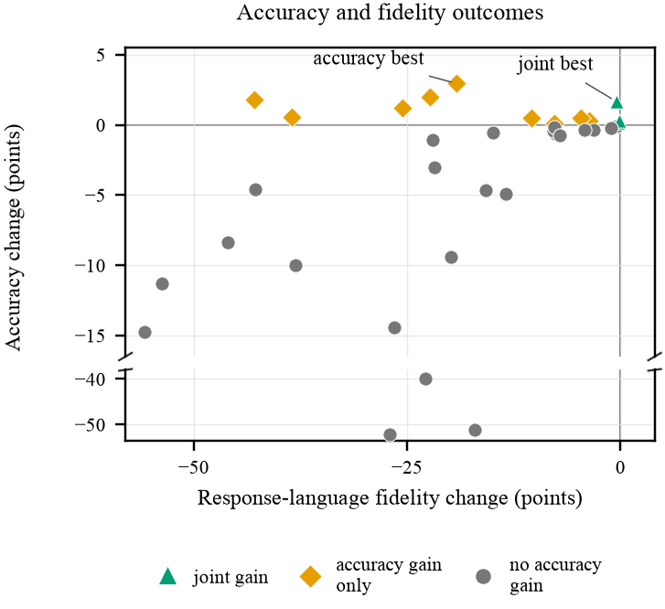

# BeyondAccuracy

### Better answers. But in whose language?

Official implementation of **Beyond Accuracy: What Language-Subspace Interventions Capture, Remove, and Improve**, accepted at **[Multi-LLL 2026](https://xiaoaugenstern.github.io/Multi-LLL-2026/)**, a workshop at AACL-IJCNLP 2026.

**[Results](#a-better-score-can-hide-a-worse-answer)** · **[Quick start](#quick-start)** · **[Reproduction guide](docs/reproduction.md)** · **[Code map](docs/code-map.md)** · **[Citation](#paper-and-citation)**

Language-subspace interventions edit LLM activations to improve multilingual reasoning. We test three separate claims: **what the subspaces capture, what projection removes, and what actually improves during generation.** The distinction matters: a mathematically correct answer can still fail the task when the model silently switches language.

<p align="center">
  
</p>

*Qwen2.5-7B on MGSM, across 37 intervention configurations. Each point is an activation-edit configuration; changes are relative to no intervention. Green marks improvements in joint accuracy: correct answers in the requested language.*

## A better score can hide a worse answer

| Qwen2.5-7B configuration | Answer accuracy ↑ | Language fidelity ↑ | Joint accuracy ↑ |
|:--|--:|--:|--:|
| No intervention | 62.80% | 99.82% | 62.62% |
| Highest answer accuracy: rank-10 MEAN-SVD projection, dose 0.5 | **65.75%** | 80.58% | 53.82% |
| Highest joint accuracy: rank-1 MEAN-SVD projection, dose 1 | 64.47% | 99.31% | **64.22%** |

The accuracy-maximizing edit gains **2.95 percentage points** in correctness but loses **8.80 points** in joint success. The best joint configuration improves by **1.60 points**. These are descriptive selections from the evaluated grid, not gains confirmed on an independent selection set.

The paper connects three kinds of evidence:

- **Geometry:** MEAN-SVD and DIFFPCA capture translation-associated variation, with similar depth profiles across four models. Capture alone does not establish language specificity.
- **Information after projection:** retrained linear probes retain over **99.7%** language accuracy across the tested settings, even where a frozen probe fails. Disrupting a classifier is different from exhausting language information.
- **Behavior:** activation edits and English/Chinese prompt switches can raise answer accuracy while damaging response-language fidelity. Joint accuracy measures both on the same response.

**Scope:** MATH and MGSM · 11 languages · Qwen2.5-7B, Qwen3-8B, R1-Distill-7B, and GLM-Z1-9B. Geometry and probing cover all four models; the intervention grid uses Qwen2.5-7B. Prompt controls extend across the four models.

## Quick start

### Explore the results without downloading a model

```bash
git clone https://github.com/pungyman/BeyondAccuracy.git
cd BeyondAccuracy
python scripts/show_results.py
```

This reads the released aggregate CSV and prints the paper's headline comparison. It uses only Python's standard library: no GPU, model weights, or dataset downloads.

### Work with the implementation

Python **3.11+**. Install a PyTorch build suitable for your hardware before running GPU experiments.

```bash
python -m venv .venv
source .venv/bin/activate
python -m pip install -e '.[dev]'
python -m pytest -m 'not slow'
```

Use an accelerator with sufficient memory for the selected 7–9B model and its context window for full extraction/generation. CPU-only work includes geometry and probing on existing activations, scoring, tests, and figure regeneration. Full activation caches can require substantial host memory and disk space.

### Regenerate paper figures from released summaries

```bash
python paper/workshop/figures/make_rewrite_assets.py
python paper/workshop/figures/make_appendix_b.py
```

These use the included aggregate results and write figures/tables beside the scripts. See the [reproduction guide](docs/reproduction.md) to obtain data, extract activations, and run the experiments.

## Find your way around

| Location | What it contains |
|:--|:--|
| [`src/`](src) | Subspace estimators, geometric diagnostics, probes, intervention operators, generation, and scoring |
| [`scripts/`](scripts) | Paper experiment entry points and engine checks |
| [`results/`](results/README.md) | Selected numerical summaries supporting the paper's figures and tables |
| [`paper/workshop/figures/`](paper/workshop/figures) | Paper figures and regeneration scripts |
| [`paper/workshop/numbers/`](paper/workshop/numbers) | Numerical snapshots used by the figure scripts |
| [`tests/`](tests) | Tests for geometry, operators, hooks, scoring, sampling, and evaluation |
| [`docs/`](docs/README.md) | Reproduction protocol, code map, and module documentation |

The historical experiment identifiers are retained so scripts, CSVs, and paper assets remain traceable: **E3** = geometry, **E10** = probe erasure, **E9** = intervention grid, **E8** = prompt controls/joint scoring.

## Paper and citation

**Beyond Accuracy: What Language-Subspace Interventions Capture, Remove, and Improve**

Shaanil Punglia, Dadhichi Telwadkar, Vaibhav Rathore, Siddharth Sureka, and Neha Bhargava.

Accepted at Multi-LLL 2026, co-located with AACL-IJCNLP 2026.

The proceedings link will be added when available. Until then, the title, authors, and implementation are recorded in [`CITATION.cff`](CITATION.cff).

```bibtex
@misc{punglia2026beyondaccuracy,
  title = {Beyond Accuracy: What Language-Subspace Interventions Capture, Remove, and Improve},
  author = {Punglia, Shaanil and Telwadkar, Dadhichi and Rathore, Vaibhav
            and Sureka, Siddharth and Bhargava, Neha},
  year = {2026},
  note = {Accepted at Multi-LLL 2026, AACL-IJCNLP workshop; proceedings link forthcoming},
  howpublished = {\url{https://github.com/pungyman/BeyondAccuracy}}
}
```

## Acknowledgments and release scope

This work builds on Zhao et al.'s [Language–Reasoning Disentangle](https://github.com/MuyuenLP/Language-Reasoning-Disentangle) and the MATH/MGSM datasets. The fixed-coefficient grid here differs from their language-wise coefficient-tuning protocol; our results do not reinterpret their published gains. See [attribution and data terms](NOTICE.md).

This release contains the paper-relevant implementation, tests, figures, and aggregate results. Model weights, raw datasets, activation tensors, and per-response generation files are obtained or generated separately. The original research workspace also contains experiments outside this paper; those are not part of this release. See [provenance](docs/provenance.md) for the selection and public-setup changes.
